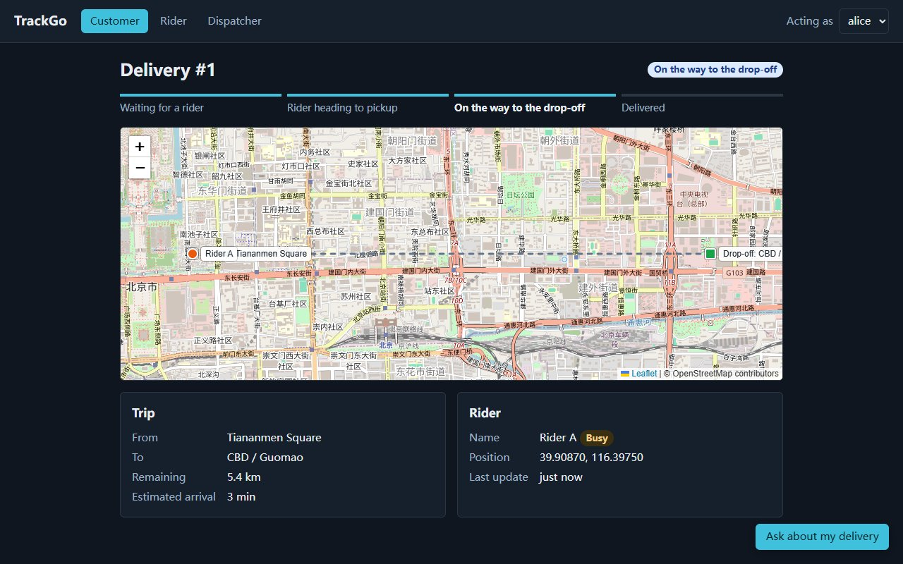
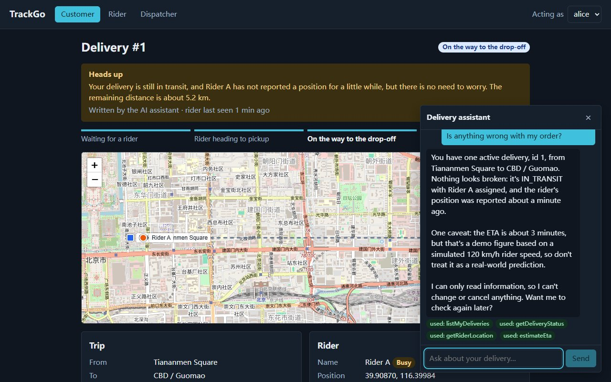
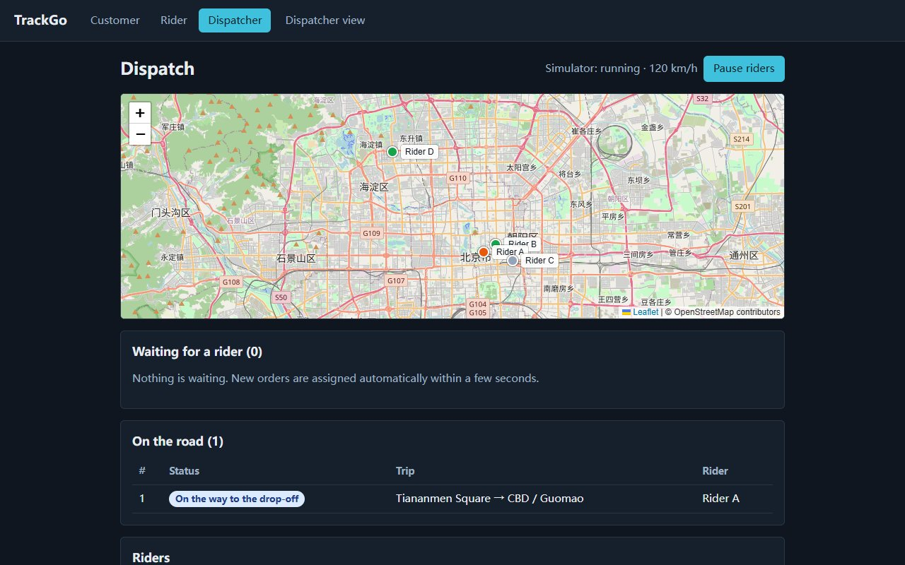

# TrackGo

A same-day delivery tracking system: customers place orders and watch the rider move on a live map,
dispatchers assign riders (by hand or automatically to the nearest idle one), and an AI assistant answers
"where is my order?" using real data from the system.

Backend: **Spring Boot 3.5 + Spring Data JPA + Spring AI**. Frontend: **React 19 + TypeScript + Leaflet**.
It runs with nothing installed except Java and Node (in-memory H2 by default, simulated riders).

| Tracking a delivery | A rider goes quiet | Dispatcher view |
|---|---|---|
|  |  |  |

> The AI text in the middle screenshot (the stalled-rider notice and the assistant's answer) was written by
> DeepSeek `deepseek-flash` on 2026-10-15; the other two screenshots contain no model output.

## What it does

* **Orders** – a customer picks a pickup and a drop-off place and places an order.
* **Live tracking** – the tracking page polls every 3 seconds and shows status, progress, the rider on a
  map, remaining distance and an estimated arrival time.
* **Automatic dispatch** – a background job assigns each pending order to the *nearest idle rider*
  (haversine distance). Dispatchers can also assign by hand.
* **Rider simulator** – riders drive to the pickup, then to the drop-off at a configurable speed, and the
  delivery advances through `ASSIGNED → IN_TRANSIT → DELIVERED` on its own.
* **Stalled-rider alert** – if a rider on an active delivery stops reporting a position for 15 seconds,
  the customer sees a notice. The *detection* is a plain rule; a language model only phrases the message.
* **AI delivery assistant** – a chat panel where the model can look up the customer's own deliveries
  through read-only tools (function calling). The customer's identity never passes through the model.
* **A strict delivery state machine** – illegal transitions are rejected with `409 Conflict`, and
  assignments are protected by row locks so a rider cannot be booked twice.

## Quick start

Prerequisites: **JDK 17+**, **Maven 3.9+**, **Node.js 18+**. No database, no Docker, no API key needed.

### 1. Backend (port 8082)

```powershell
# Only if `mvn -v` complains that JAVA_HOME points to a folder that does not exist:
$env:JAVA_HOME = 'C:\path\to\your\jdk-17'

cd backend
mvn spring-boot:run
```

On startup the demo data is inserted: customers `alice` (id 1) and `bob` (id 2), riders `Rider A`, `Rider B`,
`Rider D` (idle) and `Rider C` (offline), all around central Beijing. Data lives in memory and is lost on restart.

H2 console: <http://localhost:8082/h2-console> (JDBC URL `jdbc:h2:mem:trackgo`, user `sa`, empty password).

### 2. Frontend (port 5175)

```powershell
cd frontend
npm install
npm run dev
```

Open <http://localhost:5175>. The dev server proxies `/api` to the backend, so no CORS setup is involved.

### 3. A two-minute tour

1. **Customer** tab → *New delivery* → pick two places → *Place order*. Within about 3 seconds a rider is
   assigned and starts moving; the tracking page updates on its own.
2. **Dispatcher** tab → see riders on the map, orders waiting for a rider, and the simulator controls.
   Press *Pause riders*, go back to the tracking page and wait about 15 seconds: the "Heads up" notice appears.
3. **Rider** tab → pick a rider in *Acting as* → use *Picked up* / *Delivered* to act by hand.
4. **Customer** tab → *Ask about my delivery* to open the assistant (see below to enable it).

## Enabling the AI assistant

The assistant needs an OpenAI-compatible chat API. Without a key everything else works and the chat
simply explains that it is not configured.

```powershell
$env:LLM_API_KEY  = 'sk-...'                       # required to enable the assistant
$env:LLM_BASE_URL = 'https://api.deepseek.com'     # default; any OpenAI-compatible endpoint works
$env:LLM_MODEL    = 'deepseek-flash'                # default
cd backend
mvn spring-boot:run
```

For OpenAI use `LLM_BASE_URL=https://api.openai.com/v1` and a model such as `gpt-4o-mini`.
The key is read from the environment only; it is never written to any file.

Try asking: *"Where is my order?"*, *"How long until it arrives?"*, *"What are my deliveries?"*.
Every answer shows which tools the assistant used (green = used, red = refused).

## API overview

All endpoints are under `/api`. Errors are RFC 7807 problem-detail JSON; validation errors add an
`errors` map (field → message).

| Method + path | Purpose | Success | Errors |
|---|---|---|---|
| `POST /deliveries` | place an order (addresses + coordinates) | 201 | 400, 404 |
| `GET /deliveries/{id}` | delivery with rider and rider position | 200 | 404 |
| `GET /deliveries/{id}/tracking` | delivery + remaining distance + ETA | 200 | 404 |
| `GET /deliveries/{id}/anomaly` | is the rider stalled? (+ customer message) | 200 | 404 |
| `GET /deliveries?customerId=&riderId=&status=` | list, newest first | 200 | 400 |
| `POST /deliveries/{id}/assign` `{riderId}` | manual dispatch | 200 | 400, 404, 409 |
| `POST /deliveries/{id}/auto-assign` | assign the nearest idle rider | 200 | 404, 409 |
| `PATCH /deliveries/{id}/status` `{status}` | rider progress (`IN_TRANSIT`, `DELIVERED`) | 200 | 400, 404, 409 |
| `GET /riders?status=` | list riders | 200 | 400 |
| `PATCH /riders/{id}/location` `{lat,lng}` | report a position | 200 | 400, 404 |
| `GET /customers` | list customers (there is no login) | 200 | – |
| `GET /simulator`, `POST /simulator/pause`, `POST /simulator/resume` | simulator controls | 200 | – |
| `GET /ai/status` | is an LLM configured? | 200 | – |
| `POST /ai/chat` `{conversationId,message}` + header `X-Customer-Id` | ask the assistant | 200 | 400, 404, 502 |

The delivery state machine:

```
PENDING --assign--> ASSIGNED --status--> IN_TRANSIT --status--> DELIVERED
```

## Configuration

Set in `backend/src/main/resources/application.yml`; the sensitive ones come from environment variables.

| Property | Default | Meaning |
|---|---|---|
| `trackgo.simulator.enabled` | `true` | run the background rider simulator |
| `trackgo.simulator.tick-ms` | `3000` | time between simulation steps |
| `trackgo.simulator.speed-kmh` | `120` | simulated rider speed (also drives the ETA) |
| `trackgo.dispatch.enabled` | `true` | run the background automatic dispatcher |
| `trackgo.dispatch.retry-ms` | `3000` | time between dispatch rounds |
| `trackgo.anomaly.stale-seconds` | `15` | silence after which a rider is reported as stalled |
| `trackgo.ai.max-tool-calls` | `5` | tool calls allowed per chat message |
| `trackgo.ai.memory-messages` | `20` | messages of a conversation sent back to the model |
| `trackgo.seed.enabled` | `true` | insert the demo customers and riders |
| `LLM_API_KEY` / `LLM_BASE_URL` / `LLM_MODEL` | – / DeepSeek / `deepseek-flash` | LLM connection (environment) |

### PostgreSQL (optional)

Create the database as described at the top of `application-postgres.yml`, then:

```powershell
cd backend
mvn spring-boot:run "-Dspring-boot.run.profiles=postgres"
```

Override the connection with `TRACKGO_DB_URL`, `TRACKGO_DB_USER`, `TRACKGO_DB_PASSWORD`.
*The profile is written but has not been exercised against a real PostgreSQL yet.*

## Project layout

```
backend/src/main/java/com/trackgo
├── controller/   HTTP binding and validation only
├── service/      business rules and transactions (DeliveryService, RiderService, EtaService, ...)
├── dispatch/     nearest-idle-rider dispatching + its scheduler
├── simulation/   rider movement simulator + its scheduler
├── anomaly/      stalled-rider detection
├── ai/           chat service, tools, language-model note writer
├── geo/          haversine distance and movement maths
├── repository/   Spring Data JPA repositories and filter specifications
├── entity/       JPA entities and the delivery state machine
├── dto/          request/response records
├── exception/    business exceptions and the global error handler
└── config/       typed properties, clock, demo data seeder

frontend/src
├── api/          fetch wrapper and typed API calls
├── components/   layout, map, chat widget, badges
├── identity/     "who am I?" without a login
├── pages/        customer, tracking, rider and dispatcher screens
└── lib/          formatting helpers, landmark presets
```

## Tests

```powershell
cd backend  ; mvn test             # 51 tests: unit + integration (MockMvc, H2, a fake LLM server)
cd frontend ; npm test             # 6 unit tests
cd frontend ; npm run lint ; npm run build
```

The AI tests run the real Spring AI client and tool-calling loop against a scripted fake LLM
(`StubLlmServer`), so they need no network and no key. They prove the plumbing (tools are advertised, tool
results flow back, identity cannot be spoofed, the call budget holds); they do **not** prove how a real model
behaves.

## Known limitations

* **No authentication.** Identity is a dropdown plus an `X-Customer-Id` header. Local development only.
* **Polling, not push.** The UI refreshes every 3 seconds; there is no WebSocket.
* **Riders are simulated.** There is no rider mobile app; positions come from the simulator or a form.
* **The AI assistant is only lightly tried against a live model.** The automated tests use a scripted fake;
  it was exercised against DeepSeek `deepseek-flash` through the API on 2026-10-14 and through the web chat
  panel on 2026-10-15 (the screenshot), which is a handful of requests, not an evaluation. The ETA it quotes
  is a demo figure (simulated rider speed).
* **The assistant does not know about the stalled-rider notice.** The notice comes from a separate rule; the
  assistant only sees how old the rider's last position is, so it can say "nothing looks broken" next to a
  warning banner.
* **PostgreSQL profile untested**, and assignment locking has no concurrent load test.
